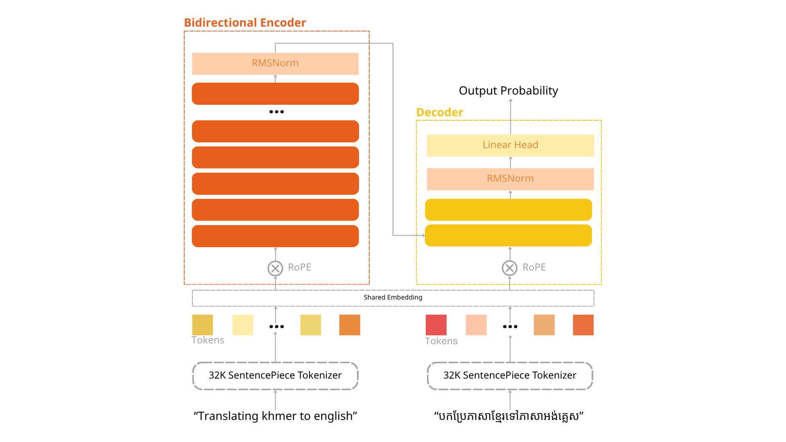
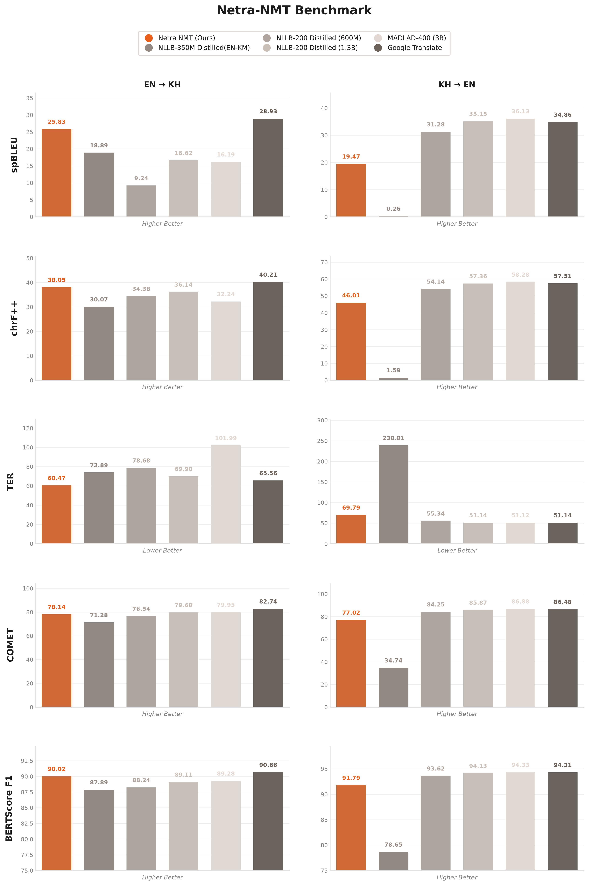

<div align="center">
  
  
</div>

<hr>

<p align="center">
  <a href="https://github.com/netra-ai-lab/Netra-NMT"><b>GitHub</b></a> |
  <a href="https://pypi.org/project/netra-nmt/"><b>PyPI</b></a> |
  <a href="https://github.com/netra-ai-lab/Netra-NMT/pkgs/container/netra-nmt"><b>Docker Image</b></a> |
  <a href="https://huggingface.co/Netra-Lab/Netra-NMT"><b>Model Download</b></a> |
  <a href="https://huggingface.co/datasets/Netra-Lab/bilingual-en-km"><b>Dataset Download</b></a> |
  <a href="https://huggingface.co/spaces/Netra-Lab/Netra-NMT"><b>Inference Space</b></a>
</p>

<p align="center">
  
  
  <a href="https://huggingface.co/Netra-Lab/Netra-NMT"></a>
  <a href="https://pypi.org/project/netra-nmt/"></a>
  <a href="https://github.com/netra-ai-lab/Netra-NMT/pkgs/container/netra-nmt"></a>
</p>

<h2>
<p align="center">
  Netra NMT: A Compact Bidirectional Encoder-Decoder Transformer for English-Khmer Translation
</p>
</h2>

<p align="center">
  English or Khmer text in, the other language out. One 77M-parameter model for both directions, trained from scratch, that runs on a CPU without PyTorch.
</p>

<p align="center">
  
</p>

<p align="center">
  <em>English→Khmer speed on an Intel i7-13700KF (16 threads) and an RTX 3060, greedy and beam-5, median ms per sentence over 20 sentences (PyTorch). On CPU, greedy, Netra NMT is 8–16× faster than both NLLB models; with beam-5 the gap shrinks to 1.1–2.1×, and on GPU beam-5 it trails NLLB-350M (144 vs 105 ms).</em>
</p>

## 1. Abstract

This repository presents Netra NMT, a compact **77M-parameter** encoder-decoder transformer for English↔Khmer translation, trained from scratch on **220 million tokens** of parallel text (4.2M bidirectional examples). The encoder reads the source with bidirectional self-attention, like BERT; the decoder generates the translation with causal self-attention and cross-attention over the encoder output.

1. **A modern transformer recipe:** rotary position embeddings (RoPE), RMSNorm with pre-normalisation, SwiGLU feed-forward blocks, and one embedding table shared by the encoder, the decoder and the tied output projection.
2. **Deep encoder, shallow decoder** (12 and 2 layers, after Kasai et al., 2021), with a KV cache, so the part that runs once per output token is small.
3. **Khmer word segmentation** with khmercut before a shared 32K SentencePiece vocabulary, so the tokenizer sees real word boundaries in a language written without spaces.

On the ALT test set (1,018 pairs, greedy) it scores **25.83 spBLEU English→Khmer**, against 18.89 for NLLB-350M (EN-KM), 16.62 for NLLB-200 1.3B and 28.93 for Google Translate. Khmer→English is weaker: **19.47 spBLEU**, against 35.15 for NLLB-200 1.3B. On CPU it translates a sentence in **65.6 ms** greedy, 8× faster than NLLB-350M.

The package runs the model on ONNX Runtime: `pip install "netra-nmt[cpu]"` (199 MB installed, no PyTorch) and a 189 MB model download, at 39 ms per sentence greedy and 64 ms beam-5 on a desktop CPU.

## 2. Dataset

Netra NMT was trained on **220 million tokens** from about **2.4 million unique English-Khmer sentence pairs** (4.2 million examples once both directions are counted). The corpus combines LLM-generated synthetic data with web-crawled parallel text, spanning legal, literary, medical, technical and conversational domains. The cleaned bilingual set is published as [Netra-Lab/bilingual-en-km](https://huggingface.co/datasets/Netra-Lab/bilingual-en-km).

### Sources

| Dataset | Type | Pairs | Domains |
| :--- | :--- | ---: | :--- |
| [Netra-Lab/khmer-english-pairs-raw](https://huggingface.co/datasets/Netra-Lab/khmer-english-pairs-raw) (MIT) | Synthetic | 200K | Legal, literary, governmental |
| [lyfeyvutha/nllb-en-km-316K](https://huggingface.co/datasets/lyfeyvutha/nllb-en-km-316K) | Synthetic | 316K | General |
| [KrorngAI/ParaCrawl-English-Khmer-v2](https://huggingface.co/datasets/KrorngAI/ParaCrawl-English-Khmer-v2) | Web crawl (ParaCrawl) | 1.5M | Web, general |
| [SeyhaLite/Translate-English-Khmer-All](https://huggingface.co/datasets/SeyhaLite/Translate-English-Khmer-All) | — | 366K | General |
| **Total** | | **2.4M** | |

### Preprocessing

1. **Deduplication.** Exact duplicate pairs are removed across all sources.
2. **Length filtering.** Pairs with extreme source/target length mismatches are discarded.
3. **Empty removal.** Pairs where either side is empty or below a minimum token count are dropped.
4. **English source normalisation.** English is NFC-normalised, whitespace-collapsed and lowercased **only when it is the `en2km` source**, so "I love Cambodia" and "i love cambodia" become the same input. English as a `km2en` target keeps its casing.
5. **Khmer word segmentation.** Khmer is segmented with khmercut wherever it appears (the `en2km` target and the `km2en` source), matching the segmented tokenizer. Khmer output is de-segmented back to natural text at inference time.

Each surviving pair is then used in both directions with a target-language marker (`<2km>` / `<2en>`), giving about 4.2 million training examples. The whole pipeline is in [`training/netra_nmt_train/scripts/recipe/`](training/netra_nmt_train/scripts/recipe/).

## 3. Model Architecture

<p align="center">
  
</p>

<p><em>Figure 1: The encoder (left) reads the source sentence with bidirectional self-attention; the decoder (right) generates the target sentence one token at a time with causal self-attention and cross-attention over the encoder output. Both sides share a 32K SentencePiece tokenizer.</em></p>

**Encoder.** The source sentence, tokenized by the shared 32K SentencePiece model (Khmer word-segmented first), goes through **12** transformer layers with bidirectional self-attention. Positions are encoded by rotating queries and keys (RoPE) inside self-attention; there is no learned position table. A final RMSNorm feeds the decoder's cross-attention.

**Decoder.** The partly generated translation goes through only **2** layers, each with three sub-layers: causal self-attention with RoPE over the tokens so far, backed by a **KV cache**; cross-attention over the encoder output; and a SwiGLU feed-forward block. A final RMSNorm feeds the tied output projection. Most of the capacity lives in the encoder, which runs once per sentence; the decoder, which runs once per output token, stays cheap.

| Feature | Detail |
| :--- | :--- |
| Rotary position embeddings | Q/K rotated inside self-attention; no learned position table, no hard length cap |
| RMSNorm (pre-norm) | Root-mean-square normalisation before each sub-layer; as stable as LayerNorm and cheaper |
| SwiGLU FFN | SwiGLU activation instead of ReLU in the feed-forward blocks |
| Shared embeddings | One table for the encoder input, the decoder input and the tied output head |
| Deep encoder / shallow decoder | 12-layer encoder, 2-layer decoder (Kasai et al., 2021) |
| KV cache | Past keys and values are kept between steps, so each step only processes the new token |
| Khmer word segmentation | khmercut before SentencePiece, so the vocabulary learns real word boundaries |

| Hyperparameter | Value |
| :--- | :--- |
| d_model | 512 |
| Encoder / decoder layers | 12 / 2 |
| Attention heads | 8 |
| FFN hidden size | 2048 |
| Position encoding | Rotary (RoPE) |
| Normalisation | RMSNorm (pre-norm) |
| Vocabulary | 32K (SentencePiece unigram, shared, Khmer-segmented) |
| Total parameters | 77M |

## 4. Evaluation

<p align="center">
  
</p>

| Direction | Metric | NLLB-350M (EN-KM) | NLLB-200 600M | NLLB-200 1.3B | MADLAD-400 3B | Google Translate | **Netra NMT (77M)** |
| :--- | :--- | ---: | ---: | ---: | ---: | ---: | ---: |
| EN → KM | spBLEU ↑ | 18.89 | 9.24 | 16.62 | 16.19 | 28.93 | **25.83** |
| EN → KM | chrF++ ↑ | 30.07 | 34.38 | 36.14 | 32.24 | 40.21 | **38.05** |
| EN → KM | TER ↓ | 73.89 | 78.68 | 69.90 | 101.99 | 65.56 | **60.47** |
| EN → KM | COMET ↑ | 71.28 | 76.54 | 79.68 | 79.95 | 82.74 | **78.14** |
| EN → KM | BERTScore F1 ↑ | 87.89 | 88.24 | 89.11 | 89.28 | 90.66 | **90.02** |
| KM → EN | spBLEU ↑ | 0.26 | 31.28 | 35.15 | 36.13 | 34.86 | **19.47** |
| KM → EN | chrF++ ↑ | 1.59 | 54.14 | 57.36 | 58.28 | 57.51 | **46.01** |
| KM → EN | TER ↓ | 238.81 | 55.34 | 51.14 | 51.12 | 51.14 | **69.79** |
| KM → EN | COMET ↑ | 34.74 | 84.25 | 85.87 | 86.88 | 86.48 | **77.02** |
| KM → EN | BERTScore F1 ↑ | 78.65 | 93.62 | 94.13 | 94.33 | 94.31 | **91.79** |

- **Scoring.** The `mutiyama/alt` test split (1,018 usable pairs), greedy decoding, PyTorch. spBLEU uses the FLORES-200 tokenizer; chrF++ is chrF with word bigrams; TER on khmercut-segmented text for Khmer targets; COMET is `Unbabel/wmt22-comet-da`; BERTScore F1 uses `xlm-roberta-base`. Netra NMT was not fine-tuned on ALT. Produced by [`evaluate_alt.py`](training/netra_nmt_train/scripts/recipe/evaluate_alt.py); per-model JSON in [`results/`](results/).
- **English → Khmer** is the strong direction: the best TER of all systems, and the best spBLEU and chrF++ after Google Translate, ahead of models 4–40× larger. On the neural metrics (COMET, BERTScore) NLLB-200 1.3B and MADLAD-400 3B are slightly ahead.
- **Khmer → English** trails NLLB-200 600M, 1.3B and MADLAD-400 3B by 11.8–16.7 spBLEU.
- **Speed.** On CPU, 65.6 ms per sentence greedy against 550.8 for NLLB-350M and 1074.9 for NLLB-600M; beam-5 735.2 against 802.7 and 1567.5 (the figure above; [`results/speed_hw.json`](results/speed_hw.json)).
- **The package is faster than the figure.** netra-nmt 1.0.0 (ONNX Runtime) takes 39.1 ms per sentence greedy and 63.5 ms beam-5 on the same CPU, against 62.6 and 701.1 for the PyTorch 0.1.0 package; beam search now stops as soon as no beam can still win, with identical output.
- **The package matches the evaluated model.** The ONNX model folder the package runs generates the same tokens as the PyTorch model on the ALT test set, greedy and beam-5, both directions ([docs/RESULTS.md](docs/RESULTS.md)).
- **More results.** [docs/RESULTS.md](docs/RESULTS.md): the speed tables, ONNX Runtime against PyTorch, and the parity check.

## 5. Install

```bash
pip install "netra-nmt[cpu]"          # CPU
pip install "netra-nmt[gpu]"          # NVIDIA GPU (onnxruntime-gpu)
# or, from a checkout:  pip install -e ".[cpu,server]"
```

| Extra | Adds |
| --- | --- |
| *(none)* | numpy, sentencepiece, khmercut, huggingface_hub. Install `cpu` or `gpu` too: the model needs ONNX Runtime |
| `cpu` | `onnxruntime` |
| `gpu` | `onnxruntime-gpu` (CUDA). Install instead of `cpu`, not with it: the two conflict |
| `server` | FastAPI + uvicorn for the web app and REST API (`netra-nmt serve`) |
| `full` | `cpu` + `server` |

The first translation downloads the model from [Hugging Face](https://huggingface.co/Netra-Lab/Netra-NMT) (`model/`, pinned to a commit in [`netra_nmt/models.py`](netra_nmt/models.py)) and caches it under `~/.cache/huggingface` (`HF_HOME`):
- `encoder.onnx` 136 MB, `decoder_step.onnx` 52 MB, tokenizer 0.9 MB: 189 MB in all (weights stored as fp16, computed in fp32).

`netra-nmt download` fetches it ahead of time; after that, `HF_HUB_OFFLINE=1` works. The CPU is enough; with the `gpu` extra, CUDA is used when available (`NETRA_NMT_DEVICE=cpu|cuda` overrides).

## 6. Usage

**Python.** `translate` loads a default translator once and reuses it.

```python
from netra_nmt import translate

translate("Hello, how are you?")                        # English -> Khmer (default)
translate("ខ្ញុំស្រលាញ់ប្រទេសកម្ពុជា។", direction="km2en")   # -> "I love Cambodia."
translate(["Good morning.", "See you tomorrow."])       # a list in, a list out
```

`NetraTranslator` holds one model for repeated use, with the decoding options:

```python
from netra_nmt import NetraTranslator

t = NetraTranslator(device="cpu")                       # "auto" (default), "cpu", "cuda", "cuda:1"
t.translate("Good morning, my friend.", mode="beam", beam_size=5)
t.translate("Good morning, my friend.", mode="sample", temperature=0.8, top_p=0.9, seed=0)
t.translate_batch(["Good morning.", "See you tomorrow."], direction="en2km")
```

`direction` is `"en2km"` (English→Khmer) or `"km2en"` (Khmer→English); `mode` is `"greedy"` (default), `"beam"` or `"sample"`. `NetraTranslator(local_dir="path/to/model")` runs your own exported model folder.

**Command line.** One sentence, a file (one sentence per line), or an interactive session.

```bash
netra-nmt --text "Hello, how are you?"
netra-nmt --text "សួស្តី, តើអ្នកសុខសប្បាយទេ?" --direction km2en --mode beam
netra-nmt --file input.txt --output output.txt --direction en2km
netra-nmt                                   # interactive (:dir, :mode, :beam, :help)
```

**Web app.** A two-pane page (source left, translation right, EN⇄KM swap), from `pip install "netra-nmt[server,cpu]"`:

```bash
netra-nmt serve                             # http://127.0.0.1:8000
netra-nmt serve --host 0.0.0.0 --port 8080 --device cpu
```

Or the Docker image, with the model inside (runs offline):

```bash
docker run --rm -p 8000:8000 ghcr.io/netra-ai-lab/netra-nmt:latest
```

**REST API.** The same server answers JSON:

```bash
curl -X POST http://127.0.0.1:8000/api/translate \
  -H 'Content-Type: application/json' \
  -d '{"text": "Hello, how are you?", "direction": "en2km", "mode": "greedy"}'
# {"translation": "...", "direction": "en2km"}
```

`GET /api/health` and `GET /health` report readiness, and `GET /api/info` returns the version, the model source and the device.

**Train, fine-tune and evaluate.** The full recipe and the tools to fine-tune on your own pairs live in [`training/`](training/README.md), a separate package with PyTorch:

```bash
bash training/setup.sh                                            # .venv with the package + the training code
bash training/check_data.sh my_pairs.tsv                          # en<TAB>km per line
bash training/finetune.sh my_pairs.tsv --name my-model            # fine-tune the published model on it
bash training/evaluate.sh published training/runs/my-model/checkpoints/best/checkpoint.pt
bash training/export.sh training/runs/my-model/checkpoints/best/checkpoint.pt   # the model folder the package runs
```

| Reference | |
| --- | --- |
| [training/README.md](training/README.md) | Setting up, data formats, fine-tuning, the full recipe, evaluation and export |
| [docs/RESULTS.md](docs/RESULTS.md) | Every measured number: quality, speed (PyTorch and ONNX Runtime), the parity check |
| [docs/ARCHITECTURE.md](docs/ARCHITECTURE.md) | The package, the two ONNX graphs and the model folder format |
| [docs/RELEASING.md](docs/RELEASING.md) | Releasing to Hugging Face, PyPI and GHCR |

## 7. Limitations

- **Khmer → English is the weaker direction.** It trails NLLB-200 1.3B by 15.7 spBLEU on ALT. For Khmer→English quality, a larger multilingual model is the better choice when you can afford it.
- **One sentence at a time.** Sources are cut at 256 tokens, and long paragraphs lose quality. Split documents into sentences first (Netra-Translate does this).
- **News-like domain in evaluation.** ALT is Wikinews; quality on other domains (chat, legal, medical) is not measured here.
- **Rare names and terms** get mistranslated: in the first ALT test sentence, Khmer→English renders "Randwick Racecourse" as "Trophystic Racing Square".

## 8. Licensing

This project is released under the MIT License (see [LICENSE](LICENSE)).
- **Weights:** MIT, like the code.
- **Libraries:** SentencePiece and khmercut are Apache-2.0; ONNX Runtime is MIT. See [THIRD_PARTY_LICENSES.md](THIRD_PARTY_LICENSES.md).
- **Training data:** [Netra-Lab/khmer-english-pairs-raw](https://huggingface.co/datasets/Netra-Lab/khmer-english-pairs-raw) is MIT. The other three sources are third-party and keep the terms of their original repos: [lyfeyvutha/nllb-en-km-316K](https://huggingface.co/datasets/lyfeyvutha/nllb-en-km-316K), [KrorngAI/ParaCrawl-English-Khmer-v2](https://huggingface.co/datasets/KrorngAI/ParaCrawl-English-Khmer-v2) and [SeyhaLite/Translate-English-Khmer-All](https://huggingface.co/datasets/SeyhaLite/Translate-English-Khmer-All) (Apache-2.0). The combined [Netra-Lab/bilingual-en-km](https://huggingface.co/datasets/Netra-Lab/bilingual-en-km) passes those terms on. Check them before commercial use.
- **Example data:** `training/examples/pairs.tsv` is 50 ALT validation pairs, CC BY 4.0 (NICT).

## References

1. **Deep Encoder, Shallow Decoder: Reevaluating Non-autoregressive Machine Translation**  
   *Jungo Kasai, Nikolaos Pappas, Hao Peng, James Cross, Noah A. Smith*  
   ICLR 2021.  
   [arXiv:2006.10369](https://arxiv.org/abs/2006.10369)

2. **RoFormer: Enhanced Transformer with Rotary Position Embedding**  
   *Jianlin Su, Yu Lu, Shengfeng Pan, Ahmed Murtadha, Bo Wen, Yunfeng Liu*  
   [arXiv:2104.09864](https://arxiv.org/abs/2104.09864)

3. **Root Mean Square Layer Normalization**  
   *Biao Zhang, Rico Sennrich*  
   NeurIPS 2019.  
   [arXiv:1910.07467](https://arxiv.org/abs/1910.07467)

4. **GLU Variants Improve Transformer**  
   *Noam Shazeer*  
   [arXiv:2002.05202](https://arxiv.org/abs/2002.05202)

5. **No Language Left Behind: Scaling Human-Centered Machine Translation**  
   *NLLB Team*  
   [arXiv:2207.04672](https://arxiv.org/abs/2207.04672)
