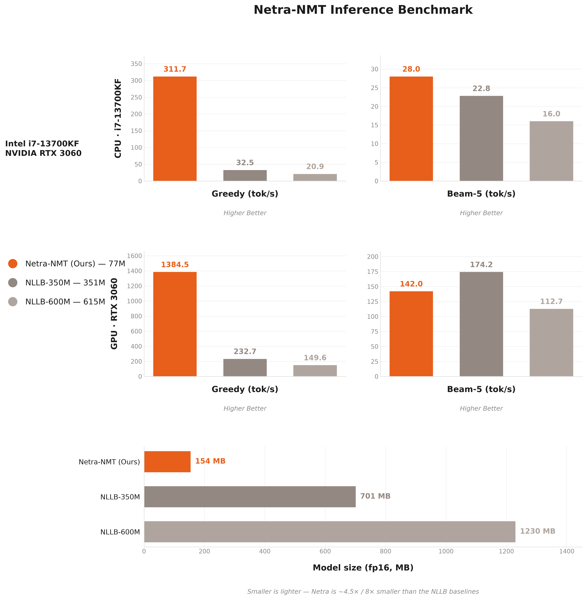

# Results

Every measured number for Netra NMT, with how it was measured. The README keeps the headline facts.

## 1. Quality on ALT

| Direction | Metric | Optimization | Netra NMT (Ours) | NLLB-350M Distilled (EN-KM) | NLLB-200 Distilled (600M) | NLLB-200 Distilled (1.3B) | MADLAD-400 (3B) | Google Translate |
|------------|--------|--------------|-----------------:|----------------------------:|--------------------------:|--------------------------:|----------------:|-----------------:|
| EN → KH | spBLEU | Higher | **25.83** | 18.89 | 9.24 | 16.62 | 16.19 | **28.93** |
| EN → KH | chrF++ | Higher | **38.05** | 30.07 | 34.38 | 36.14 | 32.24 | **40.21** |
| EN → KH | TER | Lower | **60.47** | 73.89 | 78.68 | 69.90 | 101.99 | 65.56 |
| EN → KH | COMET | Higher | **78.14** | 71.28 | 76.54 | 79.68 | 79.95 | **82.74** |
| EN → KH | BERTScore F1 | Higher | **90.02** | 87.89 | 88.24 | 89.11 | 89.28 | **90.66** |
| KH → EN | spBLEU | Higher | **19.47** | 0.26 | 31.28 | 35.15 | **36.13** | 34.86 |
| KH → EN | chrF++ | Higher | **46.01** | 1.59 | 54.14 | 57.36 | **58.28** | 57.51 |
| KH → EN | TER | Lower | 69.79 | 238.81 | 55.34 | 51.14 | **51.12** | 51.14 |
| KH → EN | COMET | Higher | **77.02** | 34.74 | 84.25 | 85.87 | **86.88** | 86.48 |
| KH → EN | BERTScore F1 | Higher | **91.79** | 78.65 | 93.62 | 94.13 | **94.33** | 94.31 |

Netra NMT (Ours) = 77M-param RoPE/RMSNorm, deep-encoder(12)/shallow-decoder(2), Khmer-segmented tokenizer, trained from scratch (no ALT fine-tuning). Greedy decoding on the `mutiyama/alt` test split (1,018 pairs). spBLEU uses the FLORES-200 tokenizer; COMET = `Unbabel/wmt22-comet-da`; BERTScore F1 = `xlm-roberta-base`. **Bold** = best in row (Ours highlighted).

Source: `results/eval_results_rope_e7_alt.json` (Netra NMT) and the other `results/*.json`, from
`training/netra_nmt_train/scripts/recipe/evaluate_alt.py` (batched greedy, PyTorch, max 120 new tokens).

## 2. The package gives the same output as the evaluated model

The ONNX model folder (`Netra-Lab/Netra-NMT` `model/`, commit `7c65031`), run through
`netra_nmt.inference`, against the PyTorch model it was exported from (`pytorch/`, the same weights
as the earlier `Darayut/netra-nmt-small`, sha256 `e202b349…`). Generated token ids compared one by one,
ALT test split, CPU, `bash training/export.sh` (2026-11-01):

| Direction | Greedy | Beam-5 |
| :--- | ---: | ---: |
| EN → KM | 1018 / 1018 identical | 1018 / 1018 identical |
| KM → EN | 1018 / 1018 identical | 1018 / 1018 identical |

The old torch package (0.1.0, `main@83dd5b9`) and 1.0.0 also give identical text on the 40 cases
in `tests/golden/` (10 ALT sentences × 2 directions × greedy/beam). khmercut 0.1.0 and 0.2.0 segment
all 1,018 ALT Khmer sentences identically.

## 3. Speed: PyTorch (0.1.0) → ONNX Runtime (1.0.0)

Same machine (Intel i7-13700KF), the 20 English sentences of `scripts/benchmark.py`, English→Khmer,
3 warm-up, median ms per sentence and output tokens per second (2026-11-01). PyTorch with 16 threads;
ONNX Runtime with its default thread count (16 threads: 37.1 / 60.8 ms).

| | Greedy ms/sent ↓ | Greedy tok/s ↑ | Beam-5 ms/sent ↓ | Beam-5 tok/s ↑ |
| :--- | ---: | ---: | ---: | ---: |
| netra-nmt 0.1.0 (PyTorch, CPU) | 62.6 | 328.5 | 701.1 | 29.4 |
| **netra-nmt 1.0.0 (ONNX Runtime, CPU)** | **39.1** | **518.1** | **63.5** | **303.6** |

Per stage (ONNX Runtime, CPU): model load 410 ms, encoder 6.6 ms for a short sentence ("the government announced a new policy yesterday."), one decoder step 2.5 ms.
Raw: `results/speed_onnx_cpu.json`, `results/speed_onnx_cpu_t16.json`.

**Why beam-5 is 11× faster.** Both versions' beam search ran all 128 steps for every sentence, because
the loop only ended when every beam had finished. 1.0.0 stops as soon as no live beam can still beat
the best finished hypothesis: a live score only falls (log-probabilities ≤ 0), so its best reachable
normalised score is `score / ((5 + 129) / 6) ** 0.6`. The result is provably the same; on the ALT test
set early-stopped and full beam search are identical on 1018/1018 pairs in both directions, and take
193 s instead of 704 s (EN→KM) and 241 s instead of 648 s (KM→EN). The same stop is in the PyTorch
reference (`training/netra_nmt_train/decoding.py`).

GPU speed on ONNX Runtime (`onnxruntime-gpu`) has not been measured yet.

## 4. Speed against NLLB (PyTorch, before the ONNX port)

English→Khmer, 20 sentences, 3 warm-up. Each model is counted with its own tokenizer, so
**ms/sentence** is the fair cross-model latency. Netra NMT here is the PyTorch 0.1.0 package (full-length
beam search). Raw: `results/speed_hw.json` (from a local benchmark script that also loads the NLLB models; not in the repo).

**CPU (i7-13700KF, 16 threads)**

| Model | Params | Size (fp16) | Greedy tok/s ↑ | Greedy ms/sent ↓ | Beam-5 tok/s ↑ | Beam-5 ms/sent ↓ |
|-------|-------:|------------:|---------------:|-----------------:|---------------:|-----------------:|
| **Netra-NMT (Ours)** | **77M** | **154 MB** | **311.7** | **65.6** | **28.0** | **735.2** |
| NLLB-350M (EN-KM) | 351M | 701 MB | 32.5 | 550.8 | 22.8 | 802.7 |
| NLLB-600M | 615M | 1230 MB | 20.9 | 1074.9 | 16.0 | 1567.5 |

**GPU (RTX 3060 12GB)**

| Model | Params | Size (fp16) | Greedy tok/s ↑ | Greedy ms/sent ↓ | Beam-5 tok/s ↑ | Beam-5 ms/sent ↓ |
|-------|-------:|------------:|---------------:|-----------------:|---------------:|-----------------:|
| **Netra-NMT (Ours)** | **77M** | **154 MB** | **1384.5** | **14.8** | 142.0 | 144.3 |
| NLLB-350M (EN-KM) | 351M | 701 MB | 232.7 | 77.2 | **174.2** | **105.2** |
| NLLB-600M | 615M | 1230 MB | 149.6 | 150.4 | 112.7 | 223.0 |

On CPU, greedy, Netra NMT is 8–16× faster than both NLLB models; with beam-5 the gap is 1.1–2.1×
(and 11× smaller still for Netra with 1.0.0, see §3). On GPU it leads in greedy (14.8 ms/sentence)
and trails NLLB-350M in beam-5 (144 vs 105 ms), measured before the beam early stop.

## 5. Size

| | |
| :--- | :--- |
| Wheel | 0.05 MB (no weights) |
| `pip install "netra-nmt[cpu]"` | 199 MB on disk in a fresh venv (onnxruntime, numpy, khmercut, sentencepiece, huggingface_hub) |
| Model download (CPU) | 181 MB in the Hugging Face cache (`model/`: encoder 136 MB, decoder step 52 MB, tokenizer 0.9 MB; weights stored as fp16) |
| PyTorch weights (`pytorch/`, for fine-tuning) | 154 MB fp16 safetensors |
